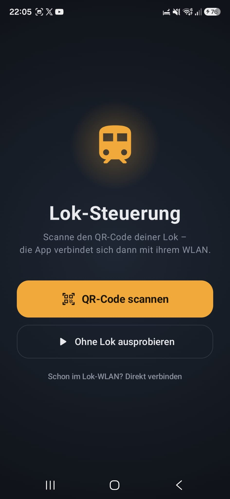
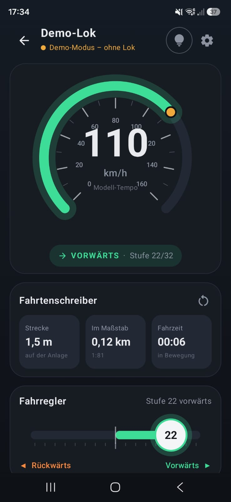

# Loksteuerung

Android-App zur Steuerung von Modellloks über WLAN, für Loks mit der
[PiedPiperS](https://github.com/jorail/PiedPiperS)-Firmware (ESP32).

QR-Code der Lok scannen, verbinden, losfahren. Ohne Zentrale, ohne Kabel, ohne Browser.

<p align="center">
  
  &nbsp;&nbsp;
  
</p>

---

## Funktionen

- **Verbinden per QR-Code:** Die App liest einen WLAN-QR-Code und verbindet sich selbst mit dem WLAN der Lok.
- **Demo-Modus:** Mit „Ohne Lok ausprobieren“ lässt sich die Steuerung auch ohne Lok testen.
- **Fahrregler mit Mittelstellung:** links rückwärts, Mitte Halt, rechts vorwärts, 32 Fahrstufen. Jede Stufe gibt eine spürbare Vibration.
- **HALTEN:** Die Lok bremst Stufe für Stufe sanft bis zum Stillstand.
- **STOPP:** Vollbremsung, der Motor wird sofort abgeschaltet.
- **Tacho und Fahrtenschreiber:** Modell-Tempo, gefahrene Strecke auf der Anlage und im Maßstab sowie die Fahrzeit. Alles wird aus der Fahrstufe berechnet, Sensoren sind nicht nötig.
- **Licht** an und aus.
- **Nur ein Fahrer pro Lok:** Ist eine Lok schon mit einem anderen Gerät verbunden, meldet die App „besetzt“. Schickt trotzdem jemand Befehle, erscheint eine Warnung.
- **Sicher beenden:** Beim Verlassen des Fahrpults hält die Lok automatisch sanft an.

## Voraussetzungen

| | |
|---|---|
| Smartphone | Android 10 oder neuer |
| Lok | ESP32 mit [PiedPiperS](https://github.com/jorail/PiedPiperS)-Firmware |
| Entwicklung | [Android Studio](https://developer.android.com/studio) (aktuelle Version) |

---

## Anleitung: App mit Android Studio bauen

### 1. Projekt herunterladen

Auf dieser Seite oben auf **Code → Download ZIP** klicken und die ZIP-Datei entpacken.
Alternativ direkt in Android Studio: **File → New → Project from Version Control**
und die Adresse dieses Repositorys einfügen.

### 2. In Android Studio öffnen

1. **File → Open** wählen.
2. Den Ordner auswählen, in dem `settings.gradle.kts` und der Ordner `app` liegen.
3. Mit **OK** bestätigen und bei Nachfrage **Trust Project** wählen.

> Liegt nach dem Entpacken ein Ordner `Loksteuerung` in einem weiteren Ordner `Loksteuerung`,
> muss der **innere** Ordner geöffnet werden. Sonst bleibt das Build-Menü ausgegraut.

### 3. Gradle-Sync abwarten

Android Studio lädt beim ersten Öffnen alle Bibliotheken herunter. Unten rechts läuft ein
Fortschrittsbalken. Fertig ist es, wenn „Sync finished“ angezeigt wird.

Ein angebotenes Upgrade des Android Gradle Plugins kann mit „Remind me later“ übersprungen werden.

### 4. Auf dem eigenen Handy starten

1. Auf dem Handy unter **Einstellungen → Telefoninfo → Softwareinformationen** sieben Mal auf **Buildnummer** tippen.
2. In den **Entwickleroptionen** das **USB-Debugging** einschalten.
3. Handy per USB anschließen und „USB-Debugging zulassen“ bestätigen.
4. In Android Studio oben das Handy auswählen und auf **Run** klicken.

### 5. APK erstellen

**Test-APK** (für das eigene Handy):

**Build → Generate App Bundles or APKs → Generate APKs**

Die Datei liegt danach unter `app/build/outputs/apk/debug/app-debug.apk`.

**Signierte Release-APK** (zum Weitergeben):

1. **Build → Generate Signed App Bundle or APK…** wählen und dann **APK**.
2. Einen bestehenden Keystore auswählen oder mit **Create new…** einen neuen anlegen.
3. **release** wählen und auf **Create** klicken.

Die Datei liegt danach unter `app/release/app-release.apk`.

> Den Keystore und seine Passwörter gut aufbewahren und **niemals** ins Repository hochladen.
> Ohne ihn lassen sich keine Updates mehr signieren.

### 6. APK installieren

Die APK aufs Handy kopieren (USB, Cloud oder Mail) und im Dateimanager antippen.
Android fragt einmalig, ob Apps aus dieser Quelle installiert werden dürfen.

---

## Bedienung

### Mit einer Lok verbinden

1. Lok einschalten. Sie öffnet ein eigenes WLAN.
2. In der App auf **QR-Code scannen** tippen und den Code der Lok scannen.
3. Den Android-Dialog „Mit Gerät verbinden“ bestätigen.
4. Das Fahrpult öffnet sich.

Ist das Handy bereits mit dem Lok-WLAN verbunden, reicht **„Schon im Lok-WLAN? Direkt verbinden“**.

### Fahren

| Element | Funktion |
|---|---|
| Fahrregler nach rechts ziehen | vorwärts fahren |
| Fahrregler nach links ziehen | rückwärts fahren |
| Neben den Reglerknopf tippen | eine Stufe schneller oder langsamer |
| **HALTEN** | sanft bis zum Stillstand abbremsen |
| **STOPP** | Vollbremsung |
| Glühbirne oben rechts | Licht an und aus |
| Zahnrad oben rechts | Maßstab und Höchsttempo einstellen |
| Pfeil oben links | Lok anhalten und trennen |

Ein Richtungswechsel während der Fahrt ist sicher: Die Lok bremst erst ab, wechselt dann die
Richtung und beschleunigt wieder.

### Mehrere Loks

Jede Lok hat ihr eigenes WLAN, und ein Handy kann immer nur in einem davon sein.
Zum Wechseln oben links auf den Pfeil tippen und den QR-Code der nächsten Lok scannen.

Wichtig: Jede Lok braucht einen **eigenen WLAN-Namen** (SSID). Er wird in der Datei `lok.ini`
der Firmware festgelegt:

```ini
[wifi]
ssid = _gruene_Dampflok_3915
password =
```

---

## QR-Code für die Lok erstellen

Die App erwartet einen **WLAN-QR-Code** im Standardformat:

```text
WIFI:T:nopass;S:<WLAN-Name der Lok>;;
```

Hat die Lok ein Passwort:

```text
WIFI:T:WPA;S:<WLAN-Name der Lok>;P:<Passwort>;;
```

Solche Codes lassen sich mit jedem WLAN-QR-Code-Generator erstellen. Am besten ausdrucken und
an die Lok oder an die Anlage kleben.

Ein Beispiel für die Standard-SSID der Firmware liegt unter
[`extras/beispiel-lok-wlan-qr.png`](extras/beispiel-lok-wlan-qr.png).

Der QR-Code aus dem PiedPiperS-Repository (`http://192.168.4.1`) funktioniert ebenfalls.
Er enthält aber keine WLAN-Daten, deshalb muss das Handy dann schon mit dem Lok-WLAN verbunden sein.

---

## Tempo und Strecke

Die Lok hat keine Sensoren, deshalb berechnet die App alle Werte aus der Fahrstufe:

- **Modell-Tempo:** Fahrstufe 32 entspricht standardmäßig 160 km/h.
- **Strecke auf der Anlage:** Modell-Tempo geteilt durch den Maßstab (Standard H0, 1:87).
- **Strecke im Maßstab:** die Strecke, die ein echter Zug zurückgelegt hätte.

Beide Werte lassen sich über das Zahnrad anpassen. Die Anzeigen sind Schätzungen, keine Messungen.

---

## Technik

| | |
|---|---|
| Sprache | Kotlin |
| Oberfläche | Jetpack Compose, Material 3 |
| Verbindung | WebSocket über OkHttp |
| QR-Scanner | Google Code Scanner (ohne Kamera-Berechtigung) |
| Mindestversion | Android 10 (API 29) |

Die App spricht dasselbe Protokoll wie die Weboberfläche der Firmware:

| Befehl | Bedeutung |
|---|---|
| `=N` | Fahrstufe N einstellen (0 bis 32), die Lok fährt sanft dorthin |
| `00` | Vollbremsung |
| `<` | Fahrtrichtung umkehren |
| `L` | Licht umschalten |
| `?` | Status abfragen |

Verbindung: `ws://192.168.4.1/ws`

### Projektstruktur

```text
app/src/main/java/com/fribchol/loksteuerung/
├── MainActivity.kt      Einstieg, QR-Scanner, Berechtigungen
├── LocoViewModel.kt     Zustand der App, Fahrlogik, Tempo-Berechnung
├── LocoLink.kt          Verbindung zur echten Lok und zur Demo-Lok
├── FirmwareModel.kt     Nachbildung der Befehlsverarbeitung der Firmware
├── LocoWifi.kt          Verbinden mit dem WLAN der Lok
├── LocoQr.kt            Auswertung der QR-Codes
└── ui/
    ├── StartScreen.kt   Startseite
    ├── ControlScreen.kt Fahrpult
    ├── SpeedGauge.kt    Tacho
    ├── DirectionSlider.kt Fahrregler
    └── Theme.kt         Farben und Design
```

---

## Danksagung

Die Firmware für die Lok stammt aus dem Projekt
[PiedPiperS](https://github.com/jorail/PiedPiperS) von jorail.
Diese App enthält keinen Code daraus, sie nutzt nur dasselbe Steuerprotokoll.